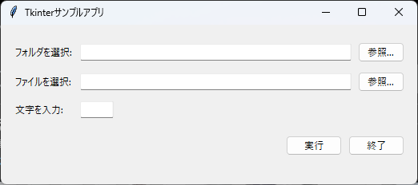

# tkinter-sample-app

Windows 11環境で動作する、Python標準ライブラリ `tkinter` を使用したデスクトップGUIアプリケーションです。  
外部ライブラリの追加インストールを一切必要とせず、標準のPython環境のみですぐに動作させることができます。  
また、PyInstallerを用いてコンソール付属のスタンドアロン `.exe` ファイルとして配布・運用することも可能です。



---

## 目次
- [プロジェクト概要](#プロジェクト概要)
- [主な機能](#主な機能)
- [必要要件](#必要要件)
- [環境構築・実行手順](#環境構築実行手順)
- [exe化（単一ファイル化）の手順](#exe化単一ファイル化の手順)
- [画面構成と使い方](#画面構成と使い方)
- [ファイル構成](#ファイル構成)
- [設定のカスタマイズ](#設定のカスタマイズ)
- [ライセンス](#ライセンス)

---

## プロジェクト概要
GUI上から「フォルダ」「ファイル」「任意の文字列」を指定し、「実行」ボタンをクリックすることで、コマンドプロンプト（コンソール）上に入力内容を表示・確認できるサンプルアプリです。

Tkinterを使ったGUI開発の学習用ベースコードや、バッチ処理・自動化スクリプトのGUIランチャーひな形として活用できます。

---

## 主な機能
- **フォルダ参照ダイアログ**: 参照ボタンからフォルダをGUIで選択し、パスを自動入力
- **ファイル参照ダイアログ**: 参照ボタンからファイルをGUIで選択し、パスを自動入力
- **コンソールへの直接出力**: 「実行」ボタン押下時、コマンドプロンプト画面に入力内容をPythonの `print` 関数で即座に出力表示
- **完全標準ライブラリ動作**: `pip install` 不要（exe化を行う場合を除く）

---

## 必要要件
- **OS**: Windows 11 / Windows 10
- **Python**: Python 3.8 以上（Windows用インストーラー付属のTcl/Tkサポートを含む標準版）

---

## 環境構築・実行手順

### 1. リポジトリのクローン（またはダウンロード）
```bash
git clone https://github.com/qack-dev/tkinter-sample-app.git
cd tkinter-sample-app
```

### 2. アプリケーションの起動（Pythonから直接実行）
コマンドプロンプトまたはPowerShellから実行します。
```bash
python app.py
```

---

## exe化（単一ファイル化）の手順

本アプリは、PyInstallerを利用して単一の実行可能ファイル（`.exe`）に変換できます。  
コンソール付きでビルドすることで、**「exe起動時にGUIとコマンドプロンプトが同時に立ち上がり、実行ボタンを押下するとコマンドプロンプトに出力される」** 運用が可能です。

### 1. PyInstallerのインストール
```bash
pip install pyinstaller
```

### 2. exeファイルのビルド
```bash
pyinstaller --onefile app.py
```
- `--onefile`: 関連ファイルをまとめた単一の `.exe` を生成します。

### 3. exeの実行
ビルドが完了すると、`dist` フォルダ内に `app.exe` が生成されます。
```text
tkinter-sample-app/
└── dist/
    └── app.exe   <-- このファイルをダブルクリックで実行
```

---

## 画面構成と使い方

| 項目 | 構成 | 説明 |
| :--- | :--- | :--- |
| **行1: フォルダ選択** | ラベル / 入力欄 / 参照ボタン | 「参照...」をクリックしてフォルダを選択すると、パスが入力欄に反映されます。直接手入力も可能です。 |
| **行2: ファイル選択** | ラベル / 入力欄 / 参照ボタン | 「参照...」をクリックしてファイルを選択すると、パスが入力欄に反映されます。直接手入力も可能です。 |
| **行3: 文字入力** | ラベル / 入力欄 | 任意の文字列を入力します（半角数字3桁程度が見えるコンパクトな幅）。 |
| **行4: 操作ボタン** | 「実行」 / 「終了」 | **[実行]**: コマンドプロンプトに入力内容を出力表示します。<br>**[終了]**: アプリケーションを安全に終了します。 |

---

## ファイル構成
```text
tkinter-sample-app/
├── .gitignore         # Gitのバージョン管理除外設定
├── README.md          # 本ドキュメント
└── app.py             # アプリケーションの全ソースコード
```

---

## 設定のカスタマイズ
`app.py` 冒頭の定数を編集することで、アプリの初期状態を簡単に変更できます。

```python
APP_TITLE = "Tkinterサンプルアプリ"                 # ウィンドウタイトル
INITIAL_DIR = os.getcwd()                          # ダイアログの初期表示フォルダ
FILE_TYPES = [("すべてのファイル", "*.*")]          # ファイル選択時の拡張子フィルタ
```

---

## ライセンス
本プロジェクトのライセンスについては [LICENSE](LICENSE) ファイルをご確認ください。

作成者: **qack-dev**
